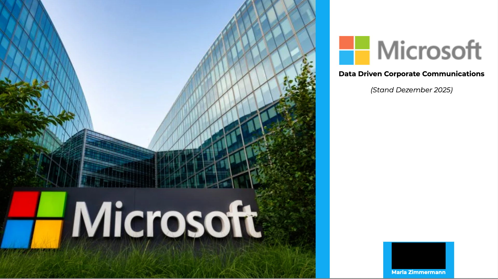

# Strategic Data Driven Communications

### Microsoft Schweiz – Strategisches Kommunikationsmanagement

Universität Hohenheim | Seminarprojekt | Dezember 2025

## Über das Projekt

Entwicklung einer daten- und technologiegestützten
Kommunikationsstrategie am Beispiel von Microsoft Schweiz.

## Thematische Schwerpunkte

- Strategisches Kommunikationsmanagement
- Stakeholder Management
- Customer Journey
- Communication Technology (CommTech)
- Strategische Wirkungsmessung (AMEC)
- Künstliche Intelligenz

## Projektpräsentation

[Zur vollständigen Präsentation (PDF)](Abgabe_Portfolio1.pdf)

## Projektkontext

Akademisches Gruppenprojekt im Rahmen des Masterstudiums
Kommunikationsmanagement und -analyse an der Universität
Hohenheim. Kein offizielles Microsoft-Projekt.
